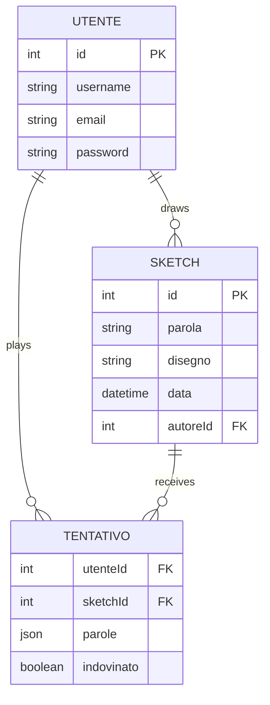

# QuickSketch

A full-stack web game where players draw a word against the clock and try to guess each other's sketches. Built with Vue 3, Express, Sequelize and SQLite.

## How it works

1. A logged-in player picks one of three random words.
2. They draw it on the canvas within 60 seconds. When time runs out, the sketch is published automatically.
3. The sketch appears in the public gallery, and other players have 10 attempts to guess the word.
4. When a player guesses correctly or runs out of attempts, the game ends for them and the word is revealed.

## Features

- **Drawing canvas:** colors, adjustable brush size, eraser and clear, built with Fabric.js
- **Guessing:** case-insensitive, with attempts saved per player and sketch, so progress survives a new login
- **Leaderboards:** top 10 drawers by sketches guessed, and top 10 players by words guessed
- **Profile:** personal statistics and the player's own sketches
- **Accounts:** registration, login and logout with server-side sessions

The server enforces the game rules:

- Players cannot guess their own sketches.
- The word stays out of API responses until the player's game is over. Only the author can see it earlier.
- Passwords are hashed with bcrypt.
- Session cookies are `httpOnly` and `sameSite=lax`.

## Tech stack

| Area | Technologies |
| --- | --- |
| Frontend | Vue 3, Vue Router, Vite, Tailwind CSS, Axios, Fabric.js |
| Backend | Node.js, Express, express-session, bcryptjs |
| Database | SQLite, Sequelize |
| Testing | Playwright |

## Getting started

Node.js 20.11 or later is required.

Install the shared dependencies from the project root:

```bash
npm install
```

Start the backend:

```bash
cd backend
npm install
cp .env.example .env    # then set SESSION_SECRET
npm run dev
```

The API runs at `http://localhost:3000`. The SQLite database is created empty on first start, so register an account to begin playing. Guessing needs a second account, because players cannot guess their own sketches.

Start the frontend in a second terminal:

```bash
cd frontend
npm install
npm run dev
```

The app runs at `http://localhost:5173`. Vite forwards `/api` and `/uploads` requests to the backend.

### Environment variables

| Variable | Purpose |
| --- | --- |
| `PORT` | Backend port, 3000 by default |
| `SESSION_SECRET` | Secret used to sign session cookies |
| `CLIENT_ORIGIN` | Frontend origin allowed by CORS |

## Project structure

```text
.
├── backend/
│   ├── controllers/    # Auth, sketch, word, leaderboard and user logic
│   ├── middleware/     # Authentication check and image saving
│   ├── models/         # Sequelize models and associations
│   ├── routes/         # REST API routes
│   └── index.js        # Express app entry point
└── frontend/
    ├── src/
    │   ├── components/ # Canvas, timer, word selector, guess form, cards
    │   ├── router/     # Routes and authentication guard
    │   └── views/      # Gallery, drawing, sketch, leaderboard, profile, auth
    └── tests/          # Playwright tests
```

## Architecture

The Vue single-page app calls a REST API under `/api`. Drawings are sent as PNG data URLs, saved to `backend/public/uploads/` and referenced by path in the database.



Table and field names are in Italian: `utente` is user, `parola` is word, `disegno` is drawing and `tentativo` is attempt.

### API

| Method | Endpoint | Auth | Description |
| --- | --- | --- | --- |
| POST | `/api/auth/register` | No | Create an account |
| POST | `/api/auth/login` | No | Log in |
| POST | `/api/auth/logout` | No | Log out |
| GET | `/api/auth/me` | Yes | Get the current user |
| GET | `/api/sketches` | No | List sketches |
| POST | `/api/sketches` | Yes | Publish a sketch |
| GET | `/api/sketches/:id` | No | Get a sketch |
| GET | `/api/sketches/:id/guesses` | Yes | Get the player's game state |
| POST | `/api/sketches/:id/guesses` | Yes | Submit a guess |
| GET | `/api/words/random` | Yes | Get three random words |
| GET | `/api/leaderboard/drawers` | No | Get the top drawers |
| GET | `/api/leaderboard/players` | No | Get the top players |
| GET | `/api/users/me/stats` | Yes | Get the player's statistics |
| GET | `/api/users/me/sketches` | Yes | Get the player's sketches |

## End-to-end tests

The Playwright suite covers the API, authentication, sketch creation, guessing, the 10-attempt limit and profile statistics. It starts the backend and frontend automatically.

```bash
cd frontend
npx playwright install
npx playwright test --project=chromium
```

The other configured projects need Google Chrome and Microsoft Edge installed.

Some tests need more than a fresh install:

- Five tests expect existing sketches or a seeded account, so they fail on an empty database.
- Two tests come from the Playwright template and need internet access.

## Known limitations

- Login sessions are kept in memory, so users must log in again after a server restart. Accounts and game data are stored in SQLite and are not affected.

## Author

Rocco Molinari
